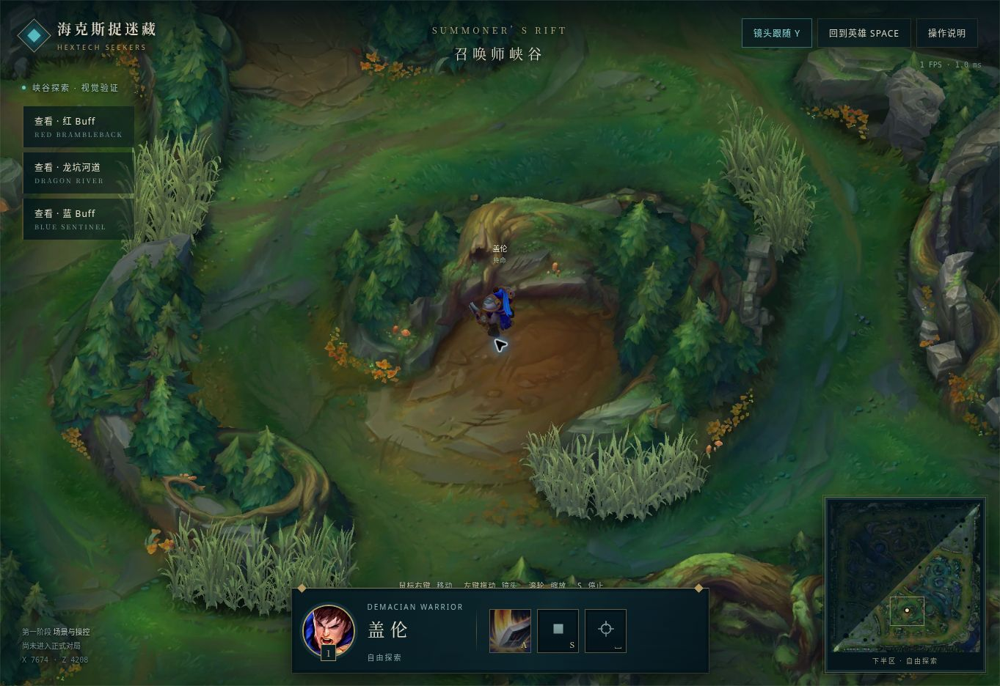

# Issue 001 实施报告

日期：2026-10-30。当前状态：**PARTIAL（可体验版本已实现，最终视觉与流畅度验收待完成）**。不标记 ACCEPTED，不开始 Issue 002。

## 已交付

默认入口更换为新版峡谷探索。接入固定提交的现版 Map11 场景与盖伦网格、贴图、骨骼动作，采用统一固定斜俯视投影；可通过右键移动、S 停止、滚轮缩放、左键拖动、Y 跟随、空格回中、小地图和三个地区按钮操作。攻击按钮只播放动作，明确标注无伤害或抓捕判定。

移动使用原始导航网格和高度，限制在下半区；A* 寻路绕开岩壁并禁止对角穿角。原场景逐像素深度与原模型动作深度用于遮挡合成。场景和英雄素材随站点提供，加载失败可见错误与重试入口。按用户后续指令，已删除旧原型入口、旧游戏代码、旧规则文档、旧测试和未使用素材。当前源码仅包含本次重做实现；旧版本通过 Git 历史恢复。

## 自动检查

- 首轮实施时 `node --test` 为 16/16（含 12 项旧版测试）；清理后的当前测试集为 4/4 通过。
- 新增 4 项检查：不同地形高度的点选投影还原；真实导航红营地→河道→蓝营地可达且不穿墙/越界；人工连续墙体绕行；全部 56 个场景图块、深度图、动作图集与导航文件完整。
- 12 项旧版回归测试已随旧实现删除，避免它们的通过结果被误解为当前已具备共享视野、AI、抓捕或计分能力。
- `node --check dist/rebuild/app.js`、Python 构建脚本语法检查、`git diff --check` 通过。

## 真实浏览器验证

在既有预览服务 `http://terminal.local:4173/` 使用真实 Chromium 页面检查：

| 检查 | 实际结果 |
| --- | --- |
| 原始场景与盖伦加载 | 可见贴图完整的红营地、蓝营地、龙坑河道及盖伦；新版无几何占位英雄 |
| 右键移动 | 初始坐标 X7674/Z4208，近距离点击后坐标与画面位置均改变 |
| 长距离导航 | 从红营地绕行至蓝营地 X11024/Z6908；镜头地点按钮本身未移动英雄 |
| S 中途停止 | 长路径移动中在 X8674/Z4365 停止；状态恢复待命，后续重新读取坐标保持相同 |
| 跟随与回中 | 拖动/地区查看取消跟随；空格重新对准英雄并恢复跟随 |
| 缩放与拖动 | 真实滚轮缩小视野、拖动改变场景中心，英雄位置保持不变 |
| 小地图边界 | 点击上半区后右键点选地面，提示“当前可探索区域为峡谷下半区”，英雄坐标未改变 |
| 操作说明 | 对话框打开/关闭有效，列出的操作与当前范围一致 |
| 动作预览 | A 触发原始攻击动作及无伤害提示，不进入正式战斗 |

## 未验收的限制

此浏览器禁用 WebGL，故采用离线 EGL 资产构建与实时 Canvas2D 合成。浏览器内帧回调实测约 1 Hz，画面提交计时约 0.1–9.3 ms；这些数值不能证明目标设备上的流畅度，尚未通过实际玩家设备的连续动画/性能验收。移动按真实经过时间消耗路径距离，切换页面可见性会重置时钟。

视觉上已确认原始场景关系、英雄识别和斜俯视样式，但没有与原客户端同分辨率、同位置做逐项对照，因此不能宣称完全复刻原客户端镜头与全部视觉效果。16 朝向、静态水/草/特效及素材来源的着色器转换差异见 [资产来源记录](asset-provenance.md)。移动端触屏入口已实现，但尚未在移动设备浏览器验收。

尚未实现新版战争迷雾、阵营独立视野、怪物实体、四英雄技能、AI、海克斯、抓捕与计分结算。当前版本不构成一局完整 V1 游戏。

## 后续条件

先对已发布的本阶段画面、英雄比例与流畅度进行验收，再安排下一个独立 Issue。不得将旧版测试通过、资产网格数量或静态截图视为全部硬要求已验收。

## 页面实拍

